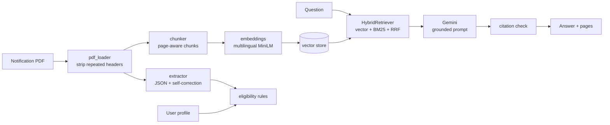

# Sarkari Saathi

[](https://github.com/Abhijeet661/sarkari-saathi/actions/workflows/ci.yml)  

Ask questions about Indian government job notifications and get answers with the exact page number, check your eligibility, and pull the key details out as clean JSON.

## Why I built this

While applying for government posts I kept running into the same problem. Every recruitment notification is a 20 to 60 page PDF, and the four things I actually need are scattered across it: eligibility, age limit (plus relaxation for my category), fee, and last date. I misread an age-relaxation rule once and nearly applied for a post I wasn't eligible for.

General chatbots don't solve this. They answer from memory, and recruitment rules change every year. So this tool answers **only from the notification you upload**, cites the page for every fact, and says "not found" instead of guessing.

## What it does

- **Ask in English, Hindi or Marathi.** Answers come back in the same language, with page citations like `[p.3]`.
- **Hybrid search.** Vector search with a multilingual embedding model, combined with BM25 keyword search through Reciprocal Rank Fusion. Vector search alone kept missing exact strings like `NIRT/REC/07/2026` or `Level 6`.
- **Citation check.** If the model cites a page it was never shown, the citation is removed and logged.
- **Structured extraction.** Posts, vacancies, qualifications, age limits, relaxation, fees and dates come out as a Pydantic-validated JSON object. If the model returns invalid JSON, the validation error is sent back so it can fix its own output.
- **Eligibility checker.** This step is plain Python rules, not the LLM. Age on the cutoff date plus category relaxation has one correct answer, so it's code with tests. When a qualification is unclear, the result is `check_manually` instead of a guess.
- **Evaluation suite.** 20 questions, including 4 that can't be answered from the notification, to measure retrieval hit rate, MRR, answer correctness, citation validity and refusal rate.
- **FastAPI backend and Streamlit UI.**

## Architecture



```
saathi/
  pdf_loader.py    PDF -> pages, drops headers/footers repeated on most pages
  chunker.py       page-aware chunks with overlap (never crosses a page)
  embeddings.py    sentence-transformers + a hash embedder for tests
  vector_store.py  numpy store with save/load
  bm25.py          Okapi BM25
  retriever.py     hybrid retrieval with Reciprocal Rank Fusion
  rag.py           grounded answering, language detection, citation check
  extractor.py     structured extraction with retry on invalid JSON
  eligibility.py   age / relaxation / qualification rules
  pipeline.py      Saathi class used by API, UI and scripts
api/main.py        FastAPI
app/               Streamlit UI
eval/              question set + evaluation script
tests/             pytest, runs offline with a fake LLM
```

## Setup

```bash
git clone https://github.com/Abhijeet661/sarkari-saathi.git
cd sarkari-saathi
python -m venv .venv
.venv\Scripts\activate          # Windows
# source .venv/bin/activate     # Linux / Mac
pip install -r requirements.txt
copy .env.example .env          # then add your GEMINI_API_KEY (free from Google AI Studio)
```

## Run it

```bash
# UI
streamlit run app/streamlit_app.py

# API, docs at http://127.0.0.1:8000/docs
uvicorn api.main:app --reload

# index a folder of PDFs from the command line
python -m scripts.ingest data/notifications/
```

Run `python scripts/make_sample_pdf.py` once to create a **fictional** sample notification (`data/sample/sample_notification.pdf`) for the tests and evaluation. Put real notifications in `data/notifications/`. They're git-ignored.

## Evaluation

```bash
python -m eval.run_eval                  # retrieval with the real embedding model
python -m eval.run_eval --with-llm       # + answer correctness, citations, refusals
python -m eval.run_eval --fake-embedder  # offline, runs in CI
```

| Metric | What it checks |
|---|---|
| hit@3 | an expected page is in the top 3 chunks |
| MRR | how high the first correct chunk is ranked |
| answer_correct | the answer contains the required facts |
| citation_valid | cites a correct page and no invented page |
| refusal_correct | says "not found" for questions the PDF can't answer |

Offline run (hash embedder, k=3): hit@3 94%, MRR 0.82. The one miss is q14 ("When will the CBT exam be held?"): keyword search matches "CBT" on the selection-process page, but the date is on page 1.

I care most about `refusal_correct`. From my LLM evaluation work, the most harmful failure is a confident wrong answer, like inventing a salary that isn't in the notification.

## Tests

```bash
pip install -r requirements-dev.txt
pytest -q
```

Tests use a fake LLM and a hash embedder, so they run in under a second with no API key. GitHub Actions runs them on every push.

## Known limitations

- Scanned PDFs (no text layer) are rejected. OCR isn't added yet.
- Tables come out of `pypdf` one cell per line, so a post's row loses its structure. Extraction still works because the LLM sees the whole page, but retrieval on table-heavy pages is weaker.
- Qualification matching is keyword-based. Uncommon degree names end up as `check_manually`.
- The sample eval set is small (one 5-page document). It shows the method, not production accuracy.

## Roadmap

- [ ] OCR fallback for scanned notifications
- [ ] table-aware parsing (pdfplumber / camelot)
- [ ] build an eval set from 10 real notifications
- [ ] reranker (cross-encoder) after hybrid retrieval
- [ ] deploy on Hugging Face Spaces

## License

MIT
